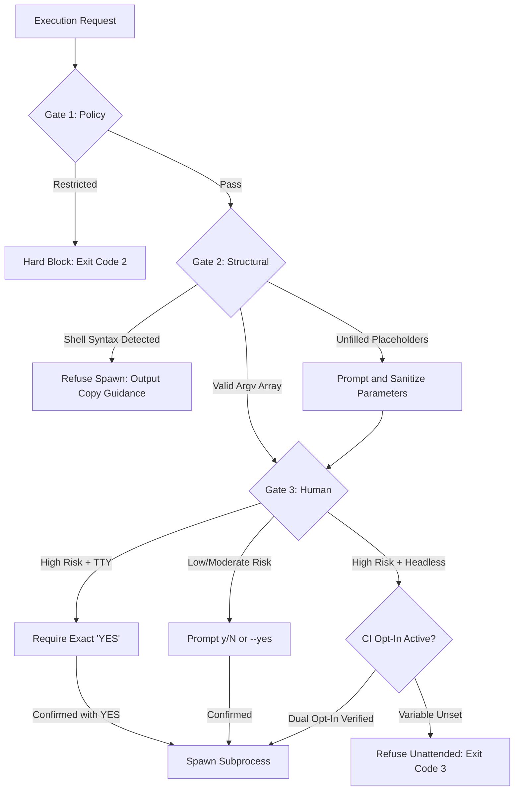

# CmdMentor

<div align="center">

[](https://www.npmjs.com/package/cmdmentor)
[](https://www.npmjs.com/package/cmdmentor)
[](LICENSE)
[](https://nodejs.org)
[](https://www.typescriptlang.org)
[](package.json)
[](#shell-and-platform-support)
[](#architecture)
[](#privacy-and-local-storage)

**Cross-platform, offline-first command reference and terminal assistant with shell-aware discovery and confirmation-gated execution.**

[Features](#features) •
[Installation](#installation) •
[Interactive TUI](#interactive-tui) •
[CLI Usage](#cli-usage-and-automation) •
[Safety Model](#three-tier-execution-safety-model) •
[Knowledge Base](#knowledge-base-and-extensibility) •
[Configuration](#configuration-and-kill-switch)

</div>

---

## Overview

Modern software development workflows span dozens of CLI tools (`git`, `docker`, `kubectl`, `find`, `tar`, `systemctl`, `netstat`), each with distinct flag conventions and differing platform behavior across operating systems.

CmdMentor provides an instant, shell-aware reference and execution assistant directly in your terminal:
- **Zero context switching:** Search and inspect commands without opening a browser or scanning man pages.
- **Shell-aware routing:** Automatically adapts commands to native shell built-ins across PowerShell, CMD, Git Bash, Linux Bash, and macOS Zsh.
- **Confirmation-gated execution:** Multi-tier safety gates prevent destructive commands from running without deliberate human confirmation.
- **Offline-first privacy:** Zero network requests, zero telemetry, local JSON configuration, and automatic credential masking.

```text
+--- CmdMentor v0.1.0 -----------------------------------------------------------------+
| Search: docker container                                              102 commands   |
+--- Matches -----------------------------+--- Command Details ------------------------+
| [Low]   docker.container.list           | Run: docker ps                             |
| [Low]   docker.container.stop           | Stop one or more running containers        |
| [Mod]   docker.container.prune          |                                            |
| [High]  docker.system.prune.all         | Risk: MODERATE (State altering)            |
| [Info]  docker.images.list              | Platforms: Linux, macOS, Windows           |
|                                         | Example: docker stop my-web-app            |
+--- Controls ----------------------------+--------------------------------------------+
| [Enter] Details  |  [Tab] Copy  |  [Ctrl+B] Bookmark  |  [Esc] Clear/Exit            |
+--------------------------------------------------------------------------------------+
```

---

## Features

- **Offline-First Engine:** Fully functional in air-gapped environments without external network dependencies. Cold-start search completes in under 150ms.
- **Shell and OS Native:** Automatically detects PowerShell, Command Prompt, Git Bash, Bash, and Zsh. Resolves POSIX aliases versus Windows binaries to avoid process spawn errors.
- **Intent-Based Search:** Search using common natural-language queries such as "undo last commit", "find process using port 8080", or "extract tar gz archive".
- **Three-Tier Safety Architecture:** Every command passes Policy, Structural, and Human confirmation gates. Destructive commands require explicit typed uppercase confirmation.
- **Global Execution Kill-Switch:** Disables process spawning immediately across TUI and CLI through local configuration.
- **Guided Placeholder Wizard:** Parses command templates (such as `<branch>` or `<directory>`), suggests defaults, and validates input to prevent shell metacharacter injection.
- **Workspace Project Scanner:** Discovers local `package.json` scripts, `Makefile` targets, and Docker Compose services, indexing repository commands automatically.
- **Knowledge Base Doctor:** Built-in semantic validator (`cmdmentor kb doctor`) verifies schema adherence, flag documentation, and referential integrity.
- **Zero Telemetry and Secret Redaction:** Search history and bookmarks reside strictly on local storage (`~/.cmdmentor`). Passwords, tokens, and API keys are masked before writing to disk.

---

## Installation

### Global Install via npm

```bash
npm install -g cmdmentor
```

Or run directly without installation via `npx`:

```bash
npx cmdmentor
```

### Local Build from Source

```bash
# Clone the repository
git clone https://github.com/Divyanshkumar62/cmd-mentor.git
cd cmd-mentor

# Install dependencies and compile production bundles
npm install
npm run build

# Link binary globally
npm link

# Verify installation
cmdmentor --version
```

---

## Interactive TUI

Launch the full-screen terminal interface:

```bash
cmdmentor
```

### Keyboard Navigation

| Key | Context | Action |
| :--- | :--- | :--- |
| `[Any text]` | Search | Instant search filter without mode switching |
| `Up` / `Down` | Search | Navigate command results list |
| `PgUp` / `PgDn` | Search | Scroll five items at a time |
| `Enter` | Search | Open Command Details view |
| `Tab` | Search | Copy highlighted command template to clipboard |
| `Ctrl+B` | Search | Toggle bookmark on selected command |
| `Esc` | Search | Clear current search query, or exit cleanly |
| `C` | Details | Copy command template to clipboard |
| `X` / `E` | Details | Open execution preview and parameter confirmation modal |
| `S` | Details | Toggle bookmark status |
| `B` / `Backspace` | Details | Return to results list |
| `Ctrl+C` | Any | Immediate exit, restoring terminal buffer state |

---

## CLI Usage and Automation

CmdMentor includes non-interactive commands designed for scripting, CI/CD pipelines, and shell integration.

### Search and Querying

```bash
# Plain-text search output for piping
cmdmentor search "git commit" --plain

# Machine-readable JSON output
cmdmentor search "docker" --json

# Filter by platform and risk level
cmdmentor search "clean" --plain --platform windows --risk high

# Display command details
cmdmentor show git.commit.staged --plain

# Copy command directly to system clipboard
cmdmentor copy filesystem.mkdir.posix
```

### Command Execution

```bash
# Execute safe informational command
cmdmentor exec filesystem.pwd.posix

# Run command template with interactive placeholder prompting
cmdmentor exec git.checkout.branch

# Non-interactive parameter substitution
cmdmentor exec git.checkout.branch --set branch=main --yes

# Automatic confirmation for low and moderate risk commands
cmdmentor exec git.status.all --yes
```

### Exit Codes

| Code | Status | Description |
| :---: | :--- | :--- |
| `0` | Success | Operation completed or child process exited cleanly. |
| `1` | Not Found | Command ID not found or search returned zero matches. |
| `2` | Policy Blocked | Execution disabled by kill-switch or usage validation error. |
| `3` | Non-Interactive | Confirmation required, but running without TTY and without `--yes`. |
| `4` | User Cancelled | Confirmation rejected by user prompt. |
| `5` | Process Error | Spawned child process returned a non-zero exit code. |

---

## Three-Tier Execution Safety Model

CmdMentor isolates command discovery from execution. Process execution must pass three independent gates:



### 1. Policy Gate
- **Restricted:** Commands involving arbitrary remote script execution or raw storage manipulation are permanently blocked from execution.
- **High Risk:** Commands causing destructive or irreversible changes (`rm -rf`, `git reset --hard`) require typing uppercase `YES`. Passing `--yes` alone will not bypass this gate.

### 2. Structural Gate
- Commands execute via `spawn(..., { shell: false })` using explicit argument arrays.
- Commands requiring shell features (pipes, redirection, chaining) are refused from direct process execution. CmdMentor provides a clear copy command instead.
- Placeholders are sanitized against shell metacharacters (`;`, `|`, `$()`, backticks).

### 3. Human Gate

| Execution Environment | Informational / Low / Moderate | High Risk | Restricted |
| :--- | :---: | :---: | :---: |
| **Interactive Terminal** | Prompt `[y/N]` | Must type exact `YES` | Blocked |
| **CLI `--yes` Flag** | Executes | Refused | Blocked |
| **Headless (No TTY, No `--yes`)** | Refused (Exit 3) | Refused (Exit 3) | Blocked |
| **Unattended CI Opt-In** | Executes | Executes with audit banner | Blocked |

#### Unattended CI Automation for High-Risk Commands
For CI environments requiring destructive execution, both the environment variable and `--yes` flag must be set:

```bash
CMDMENTOR_ALLOW_UNATTENDED_HIGH_RISK=1 cmdmentor exec filesystem.rm.posix --yes
```

---

## Knowledge Base and Extensibility

CmdMentor includes 102 verified commands across 14 technical domains:
`filesystem`, `git`, `docker`, `network`, `process`, `archive`, `system`, `kubernetes`, `database`, `cloud`, `ssh`, `text`, `security`, and `package`.

### Quality Auditing via Knowledge Base Doctor

```bash
# Audit all bundled and project commands
cmdmentor kb doctor

# Strict validation of bundled entries only
cmdmentor kb doctor --bundled-only
```

`kb doctor` validates:
- Schema conformance across all command entries.
- Integrity of `relatedCommands` references.
- Accuracy of risk ratings against command templates.
- Requirement for reversibility guidance on destructive commands.

### Adding Custom Command Packs

Create a JSON file at `~/.cmdmentor/custom/team-commands.json`:

```json
[
  {
    "id": "custom.deploy.staging",
    "name": "deploy staging",
    "title": "Deploy branch to staging cluster",
    "description": "Pushes built container images and triggers staging deployment.",
    "commandTemplate": "kubectl apply -k overlays/staging",
    "platforms": ["linux", "macos", "windows"],
    "shells": ["bash", "zsh", "powershell"],
    "category": ["custom", "kubernetes"],
    "tags": ["deploy", "staging"],
    "aliases": ["ship to staging"],
    "flags": [],
    "examples": [
      {
        "command": "kubectl apply -k overlays/staging",
        "explanation": "Applies kustomize staging overlay."
      }
    ],
    "risk": {
      "level": "moderate",
      "destructive": false,
      "requiresElevation": false
    },
    "verification": {
      "status": "reviewed",
      "lastReviewed": "2026-10-28",
      "source": "Platform Engineering"
    }
  }
]
```

Custom commands are loaded on startup and indicated with a `[Custom]` source badge.

---

## Configuration and Kill-Switch

User preferences and runtime toggles are saved locally in `~/.cmdmentor/config.json`.

```bash
# View active settings
cmdmentor config get

# Emergency Kill-Switch: Disable all command execution
cmdmentor config set execution.enabled false

# Re-enable command execution
cmdmentor config set execution.enabled true

# Manage execution history
cmdmentor history list
cmdmentor history clear

# Manage bookmarks
cmdmentor bookmarks list
```

---

## Development

```bash
# Run unit and integration tests
npm test

# Run TypeScript typecheck
npm run typecheck

# Validate knowledge base schema and integrity
npm run test:kb

# Rebuild distribution bundles
npm run build
```

---

## License

Distributed under the **MIT License**. See [LICENSE](LICENSE) for details.
